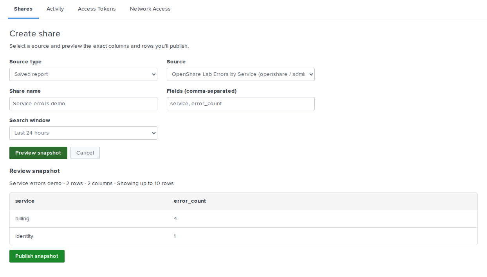
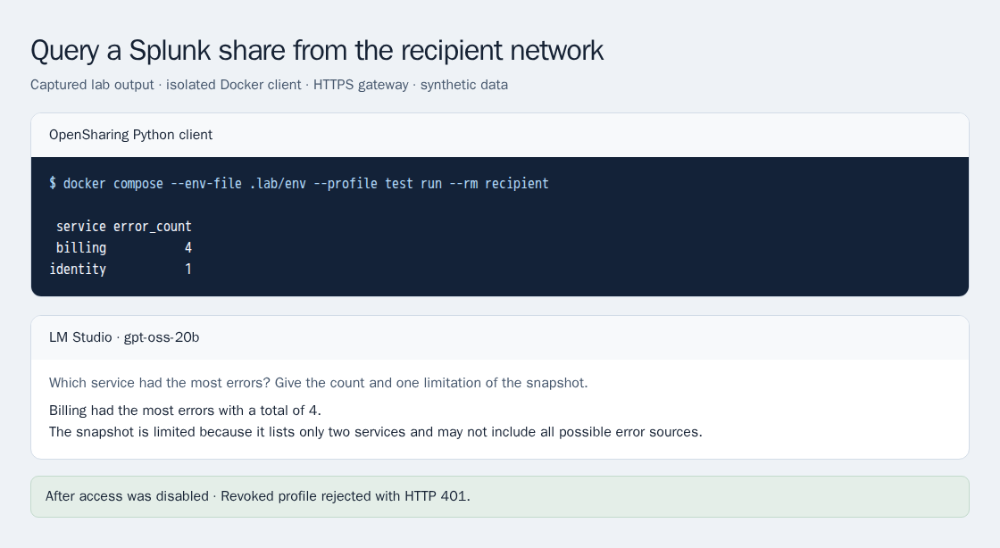
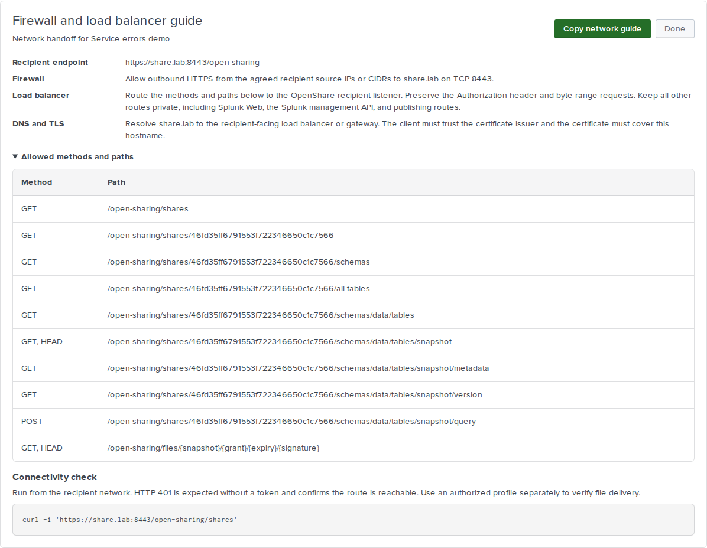
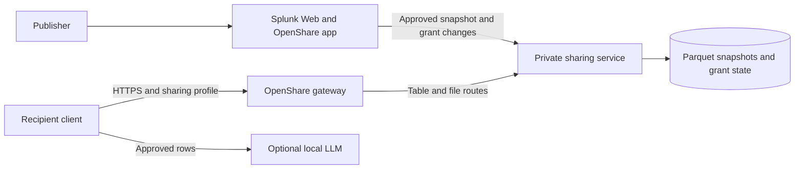

# OpenShare for Splunk Enterprise

Publish a read-only table from a Splunk Enterprise index or saved report. Choose the fields and time window in Splunk Web, preview the snapshot, and issue an expiring OpenSharing profile. Recipients read the published data over HTTPS with a standard client. They need only the profile and access to the OpenShare gateway.

## See it work

**Publish from Splunk Web.** The publisher reviews the exact columns and a sample of the snapshot before making it available.



**Read from the recipient network.** In this lab run, a Python client on a separate Docker network discovered the authorized table and downloaded its Parquet data through the HTTPS gateway. LM Studio summarized the returned rows. After the share was disabled, the same profile received HTTP 401.



The demo uses synthetic billing and identity events. The recipient container has its own network on the same machine and reaches the lab only through the sharing gateway.

## Quick start

### 1. Start the lab

Use a Linux host with Docker Engine, the Docker Compose plugin, Git, OpenSSL, and curl. You need permission to run Docker and free loopback ports **8000** and **8443**. Review the Splunk license and General Terms before starting. The startup script passes the official image’s acceptance flags. [Splunk Enterprise container setup](https://help.splunk.com/en/splunk-enterprise/administer/install-and-upgrade/10.6/install-splunk-enterprise-in-virtual-and-containerized-environments/deploy-and-run-splunk-enterprise-inside-a-docker-container)

```bash
git clone https://github.com/dpwtheitguy/SplunkAppForOpenShareProtocol.git
cd SplunkAppForOpenShareProtocol
./lab/up.sh
```

The script generates lab credentials and TLS certificates, starts Splunk Enterprise 10.6.1 and the sharing service, installs the app, and seeds the synthetic indexes and reports. If you recently joined the Docker group and your current shell still has its old membership, use `sg docker -c './lab/up.sh'`.

### 2. Publish a share

Open [OpenShare in Splunk Web](http://127.0.0.1:8000/en-US/app/openshare/openshare). Sign in as `openshare_publisher` with the password generated for this checkout:

```bash
sed -n 's/^PUBLISHER_PASSWORD=//p' .lab/env
```

1. Select **Create share**, set **Source type** to **Saved report**, and choose **OpenShare Lab Errors by Service**.
2. Give the share a name, select the last 24 hours, and enter `service, error_count` in **Fields**.
3. Click **Preview snapshot**, review the columns and rows, and click **Publish snapshot**.
4. Copy the firewall and load balancer guide if needed. Then click **Generate profile** on the share, enter a recipient label and expiry, and download the profile.

To try the index workflow, choose `openshare_lab` and preview `source, sourcetype`. The limited publisher can read that index. The lab also seeds `openshare_restricted` to exercise Splunk’s role restrictions.

### 3. Read from the isolated client

Copy the downloaded profile to the lab’s recipient directory. Replace the example source path with the location of your download. The profile contains a bearer credential.

```bash
install -m 600 /path/to/downloaded/openshare.share .lab/recipient/profile.share
docker compose --env-file .lab/env --profile test build recipient
docker compose --env-file .lab/env --profile test run --rm recipient
```

The demo runner expects the **Errors by Service** report and prints the two approved columns. The client resolves `share.lab` on the isolated Docker network and trusts the lab CA mounted by Compose. For other shares, use the stock Python connector with the profile. [OpenSharing connectors](https://github.com/OpenSharing-IO/OpenSharing#connectors)

```python
import delta_sharing

profile = "/recipient/profile.share"
client = delta_sharing.SharingClient(profile)
table = client.list_all_tables()[0]
table_url = f"{profile}#{table.share}.{table.schema}.{table.name}"
print(delta_sharing.load_as_pandas(table_url).to_string(index=False))
```

### 4. Ask an LLM and test revocation

Paste the returned table into LM Studio Chat with this prompt:

> Which service had the most errors? Give the count and one limitation of the snapshot.

The model sees the approved rows. The Python client holds the profile and token. [LM Studio local chat](https://lmstudio.ai/docs/app/offline)

In OpenShare, **Activity** shows the snapshot request and file delivery. Revoke the recipient’s grant in **Access Tokens**, then check that the same profile receives HTTP 401:

```bash
docker compose --env-file .lab/env --profile test run --rm -e EXPECT_REVOKED=1 recipient
```

Previously issued file URLs can remain valid for up to five minutes, bounded by the grant’s expiration. Recipients retain files they already downloaded.

## Firewall and load balancer handoff

Publishing opens a copyable **Network guide**. Reopen it from the share’s row or use **Network Access** for the listener-wide route list. The guide gives network engineers the destination host and TCP port, allowed HTTP methods and paths, DNS and certificate requirements, and a token-free connectivity check. The copied handoff contains route templates for signed downloads.

The lab endpoint is `https://share.lab:8443/open-sharing`. A token-free request to `/open-sharing/shares` should return **HTTP 401** from a network that can resolve the hostname and trust the lab CA. Use a valid profile to verify data delivery. Keep Splunk Web, the Splunk management API, and OpenShare’s publishing endpoint on private routes.



## How the lab fits together



| Surface | Lab access |
| --- | --- |
| Splunk Web | Host loopback, TCP 8000 |
| OpenShare HTTPS gateway | Host loopback, TCP 8443. The recipient network uses the `share.lab` alias. |
| Splunk management, publishing, and storage | Private Docker network or volumes |
| Recipient profile | A bearer credential scoped to one share. The service stores a SHA-256 verifier. |

Admins can use **Logging** to toggle recipient access auditing and enable verbose diagnostics for 30 minutes. The app keeps audit events for share and grant changes. To inspect the Splunk audit mirror, sign in as `admin` using `SPLUNK_PASSWORD` from `.lab/env` and run:

```spl
index=openshare_audit sourcetype=openshare:audit
```

## Verify and troubleshoot

```bash
./lab/test-unit.sh
./lab/verify.sh
```

The browser regression publishes an index and a report, checks permissions and the network guide, injects a billing event, verifies that refresh returns the changed count, and checks token rotation and revocation. It leaves screenshots in `.lab/test-artifacts/` and uses temporary profiles. For a manual refresh demo, add an event before clicking **Refresh** on the share:

```bash
docker compose --env-file .lab/env exec -T --user splunk splunk \
  /opt/splunk/bin/splunk cmd python - --append-billing < lab/seed.py
```

| Symptom | Check |
| --- | --- |
| Splunk Web is still starting | Run `docker compose --env-file .lab/env ps` and wait for Splunk to report healthy. |
| Recipient receives HTTP 401 | Confirm the profile is current and the share is enabled. Issue a fresh profile after rotation or revocation. |
| TLS or name resolution fails | Use the Compose recipient runner, which mounts the lab CA and resolves `share.lab` on the recipient network. |
| Demo reports are empty | Rerun `./lab/up.sh` to seed fresh synthetic events and use a time window that includes them. |

Stop the lab while retaining its Docker volumes:

```bash
docker compose --env-file .lab/env down
```

## MVP scope

OpenShare serves scalar string columns and one active snapshot per share. A refresh preserves active recipient grants. The lab uses a local CA, a deployment-mounted integration secret, and persistent local snapshot storage. A production deployment still needs private-link TLS, managed secrets, role and audit retention configuration, and automated snapshot retention.

The Splunk app is under [`app/openshare/`](app/openshare/), the OpenSharing provider is in [`service/`](service/), and the Docker lab and browser tests are in [`lab/`](lab/). See the [MVP PRD](PRD.md) for the design and acceptance criteria.
